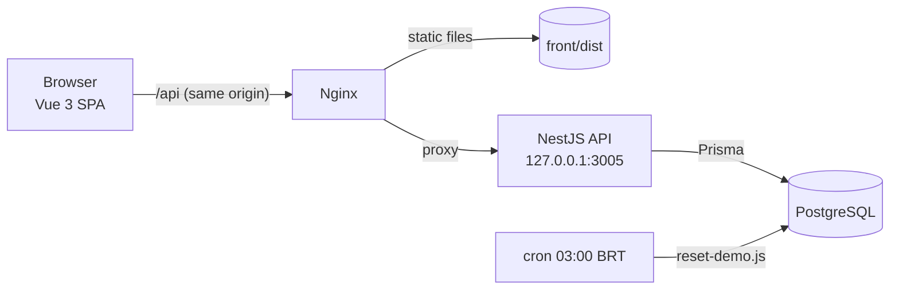

# Architecture and design decisions

🇧🇷 [Leia em português](ARCHITECTURE.md)

## Overview

- **Monorepo**: `back/` (NestJS 11, Prisma 6, PostgreSQL) and `front/` (Vue 3.5, Pinia, Vue Router, Tailwind CSS 4, Chart.js).
- **Same origin in every environment**: Vite proxies `/api` in development, and Nginx does it in production. That removes CORS, and the refresh cookie can be `SameSite=Strict`.

## Risk model

| Concept | Rule |
| --- | --- |
| Probability | 1 rare · 2 unlikely · 3 possible · 4 likely · 5 almost certain |
| Impact | 1 negligible · 2 minor · 3 moderate · 4 major · 5 catastrophic |
| Score | `probability × impact` (1-25) |
| Level | 1-4 **Low** · 5-9 **Medium** · 10-16 **High** · 20-25 **Critical** |
| Residual risk | Optional probability/impact after the corrective actions. It can never exceed the inherent score. |

`score` and `residualScore` are **stored** so lists can be sorted and filtered in SQL. `level` is derived and returned by the API. The same pure function exists in the API (`back/src/risks/risk-level.ts`) and in the SPA (`front/src/utils/risk.ts`), and both are unit-tested.

## Multi-tenancy and authorization

- Every user belongs to one **organization**, and every query is scoped by the `organizationId` taken from the access token. A resource from another organization answers **404**, never 403, so its existence is not leaked. An e2e test covers this.
- Roles: `ADMIN` (everything + users), `MANAGER` (risks, actions, categories), `VIEWER` (read + comment).
- Global guards run in order: **rate limit → JWT → role → demo restrictions**. Routes opt out with `@Public()`, opt in with `@Roles()` and `@DemoForbidden()`.

## Authentication

| Token | Where | Lifetime |
| --- | --- | --- |
| Access JWT | JavaScript memory only (never `localStorage`) | 15 min |
| Refresh token | `httpOnly`, `SameSite=Strict`, `Secure` cookie on `/api/auth` | 7 days |

- Refresh tokens are random 384-bit values stored as **SHA-256 hashes** and **rotated** on every use.
- **Reuse detection**: presenting an already-rotated token revokes every session of that user. The shared demo user is excluded, so one visitor cannot log the others out.
- On page load the SPA calls `/auth/refresh` to restore the session. On a 401, the HTTP client refreshes **once** and retries. Concurrent requests share the same refresh, and tabs are serialized with the Web Locks API so they never race on cookie rotation.
- Passwords use **argon2id**. Login always runs a hash verification, so response time does not reveal whether an email exists.

## Audit trail

Every write to risks, actions, comments, categories and users records an `AuditLog` row **in the same transaction** as the change. The row holds a field-level diff `{ field: [before, after] }`. The risk page renders it as a timeline, and the dashboard derives "closed per month" from status transitions to `CLOSED`.

## Demo mode

- The demo organization has `isDemo = true`. Its visitors sign in with one click (`POST /api/auth/demo`).
- **Blocked** with `403 DEMO_RESTRICTED`: creating or editing users, changing passwords, renaming the demo account.
- **Capped** with `403 DEMO_LIMIT_REACHED`: max risks/actions/comments/categories per organization (env-configurable). Data is restored daily, so the caps behave as daily limits.
- **Nightly reset**: a cron job runs `dist/scripts/reset-demo.js`. In one transaction it deletes the demo organization (cascade) and recreates it from `back/src/demo/seed/demo-data.ts`.
- All seed dates are **relative to the reset moment**, so the dashboard trend, overdue actions and upcoming reviews always look current.
- The dataset builder is a pure function and is unit-tested: no future dates, consistent scores, valid references.
- Language and theme preferences of the shared demo user stay in the visitor's browser, so one visitor does not change them for the next.

## Errors

The API always answers `{ statusCode, code, message, details? }` with a stable `code` (`VALIDATION_ERROR`, `DEMO_LIMIT_REACHED`...). The SPA translates codes into PT-BR or EN instead of showing server messages.

## Front end without a UI library

- Components are plain Vue + Tailwind: buttons, modal, toasts, confirm dialog, pagination, a 5×5 risk matrix, a score picker and an icon set drawn on a 24×24 grid.
- Chart.js is the only visual dependency. It is loaded in its own chunk, only on the dashboard.
- Filters, sorting and paging of the risk list live in the **URL**. Clicking a heat-map cell links to `/risks?probability=4&impact=5`.
- Dark mode uses Tailwind's class strategy, applied before the first paint to avoid a flash.
- i18n uses `vue-i18n`. The English messages are type-checked against the Portuguese schema, so a missing key fails the build.
