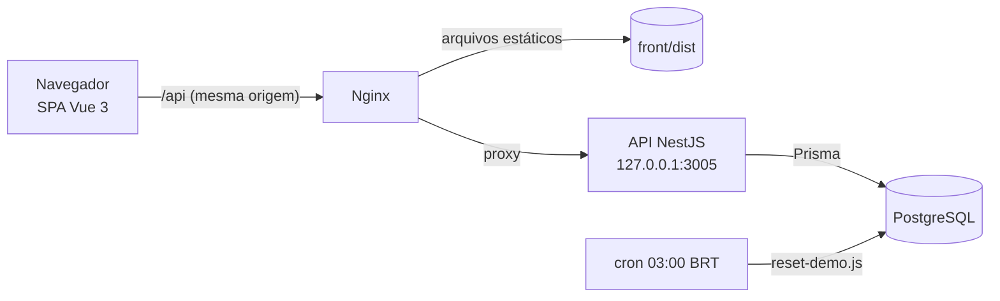

# Arquitetura e decisões de projeto

🇺🇸 [Read in English](ARCHITECTURE.en.md)

## Visão geral

- **Monorepo**: `back/` (NestJS 11, Prisma 6, PostgreSQL) e `front/` (Vue 3.5, Pinia, Vue Router, Tailwind CSS 4, Chart.js).
- **Mesma origem em todos os ambientes**: o Vite faz proxy de `/api` no desenvolvimento, e o Nginx faz o mesmo em produção. Isso elimina o CORS e permite que o cookie de refresh seja `SameSite=Strict`.

## Modelo de risco

| Conceito | Regra |
| --- | --- |
| Probabilidade | 1 rara · 2 improvável · 3 possível · 4 provável · 5 quase certa |
| Impacto | 1 insignificante · 2 menor · 3 moderado · 4 maior · 5 catastrófico |
| Score | `probabilidade × impacto` (1-25) |
| Nível | 1-4 **Baixo** · 5-9 **Médio** · 10-16 **Alto** · 20-25 **Crítico** |
| Risco residual | Probabilidade/impacto opcionais depois das ações de correção. Nunca pode passar do score inerente. |

`score` e `residualScore` ficam **gravados** no banco, para permitir ordenar e filtrar as listas em SQL. O `level` é derivado e devolvido pela API. A mesma função pura existe na API (`back/src/risks/risk-level.ts`) e na SPA (`front/src/utils/risk.ts`), e as duas têm testes unitários.

## Multi-tenant e autorização

- Cada usuário pertence a uma **organização**, e toda consulta é filtrada pelo `organizationId` do access token. Um recurso de outra organização responde **404**, nunca 403, para não revelar que ele existe. Um teste e2e cobre isso.
- Papéis: `ADMIN` (tudo + usuários), `MANAGER` (riscos, ações, categorias), `VIEWER` (leitura + comentários).
- Os guards globais rodam nesta ordem: **rate limit → JWT → papel → restrições do demo**. As rotas saem da autenticação com `@Public()` e entram nas regras com `@Roles()` e `@DemoForbidden()`.

## Autenticação

| Token | Onde fica | Validade |
| --- | --- | --- |
| Access JWT | Só na memória do JavaScript (nunca no `localStorage`) | 15 min |
| Refresh token | Cookie `httpOnly`, `SameSite=Strict`, `Secure` em `/api/auth` | 7 dias |

- Os refresh tokens são valores aleatórios de 384 bits, guardados como **hash SHA-256** e **rotacionados** a cada uso.
- **Detecção de reuso**: apresentar um token que já foi rotacionado revoga todas as sessões daquele usuário. O usuário demo compartilhado fica de fora dessa regra, para um visitante não derrubar a sessão dos outros.
- Ao carregar a página, a SPA chama `/auth/refresh` para restaurar a sessão. Num 401, o cliente HTTP faz o refresh **uma vez** e repete a requisição. Requisições simultâneas compartilham o mesmo refresh, e as abas são serializadas com a Web Locks API, para nunca disputarem a rotação do cookie.
- As senhas usam **argon2id**. O login sempre executa uma verificação de hash, para o tempo de resposta não revelar se o e-mail existe.

## Histórico de alterações (auditoria)

Toda escrita em riscos, ações, comentários, categorias e usuários grava uma linha em `AuditLog` **na mesma transação** da alteração. A linha guarda um diff campo a campo `{ campo: [antes, depois] }`. A página do risco exibe isso como uma linha do tempo, e o dashboard calcula os "encerrados por mês" a partir das transições de status para `CLOSED`.

## Modo demonstração

- A organização demo tem `isDemo = true`. Os visitantes entram com um clique (`POST /api/auth/demo`).
- **Bloqueado** com `403 DEMO_RESTRICTED`: criar ou editar usuários, trocar senhas, renomear a conta demo.
- **Limitado** com `403 DEMO_LIMIT_REACHED`: máximo de riscos/ações/comentários/categorias por organização, configurável por variável de ambiente. Como os dados são restaurados todo dia, esses tetos funcionam como limites diários.
- **Reset noturno**: um cron roda `dist/scripts/reset-demo.js`. Numa única transação, ele apaga a organização demo (em cascata) e a recria a partir de `back/src/demo/seed/demo-data.ts`.
- Todas as datas do seed são **relativas ao momento do reset**, então a tendência do dashboard, as ações atrasadas e as próximas revisões sempre parecem atuais.
- O montador do conjunto de dados é uma função pura com testes unitários: sem datas no futuro, scores consistentes, referências válidas.
- As preferências de idioma e tema do usuário demo compartilhado ficam no navegador do visitante, para um visitante não mudá-las para o próximo.

## Erros

A API sempre responde `{ statusCode, code, message, details? }`, com um `code` estável (`VALIDATION_ERROR`, `DEMO_LIMIT_REACHED`...). A SPA traduz os códigos para PT-BR ou EN, em vez de exibir as mensagens do servidor.

## Front sem biblioteca de UI

- Os componentes são Vue + Tailwind puros: botões, modal, toasts, diálogo de confirmação, paginação, matriz de risco 5×5, seletor de score e um conjunto de ícones desenhado num grid de 24×24.
- O Chart.js é a única dependência visual. Ele fica num chunk separado, carregado só no dashboard.
- Filtros, ordenação e paginação da lista de riscos ficam na **URL**. Clicar numa célula da matriz de calor leva para `/risks?probability=4&impact=5`.
- O tema escuro usa a estratégia de classe do Tailwind, aplicada antes da primeira pintura da tela para evitar o "piscar" claro.
- O i18n usa `vue-i18n`. As mensagens em inglês são checadas pelo TypeScript contra o schema em português, então uma chave faltando quebra o build.
